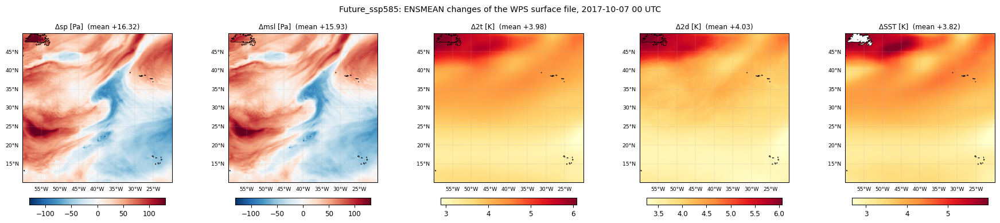
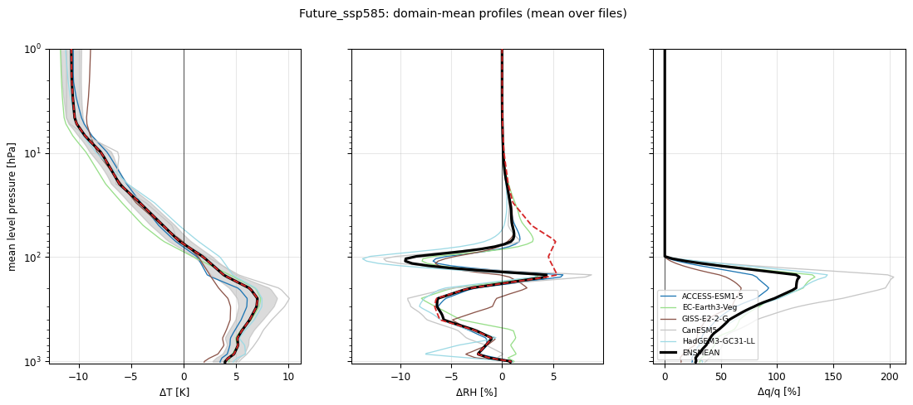
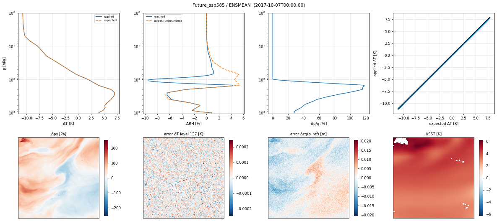

# Multi-model PGW for WRF with IFS/ERA5 model-level input

Pseudo-global warming (PGW) perturbation of the IFS/ERA5 **model-level**
GRIB files (137 hybrid levels) that WPS reads to build the initial and
boundary conditions of WRF, driven by monthly CMIP6 climate deltas on
pressure levels. The workflow selects $X$ CMIP6 models (from a user list or
automatically), runs one or several scenarios (attribution and
end-of-century projections) and produces $X+1$ perturbed sets of input files
per scenario: one per model and one for the multi-model ensemble mean
(ENSMEAN). A verification step checks every perturbed field against its
expected change and writes a self-contained HTML report.

This is the WRF counterpart of the HARMONIE workflow
[`pgw_workflow_ModelLevels`](https://github.com/ccalvosa/pgw_workflow_ModelLevels).
The 3D method, the model selection, the ENSMEAN and the verification are the
same. The differences are the input layout (model levels and surface fields in
separate files), the regular latitude–longitude grid, and the perturbation of
the WPS surface file consistently with the adjusted model levels (§5.3).

The methodology follows PGW4ERA5 ([Brogli et al., 2023](https://doi.org/10.5194/gmd-16-907-2023)).

🌐 **Project website:** <https://ccalvosa.github.io/pgw_workflow_ModelLevels_WRF/>

📄 **Technical note (PDF):** [`docs/latex/pgw_wrf_modellevels_technical_note.pdf`](docs/latex/pgw_wrf_modellevels_technical_note.pdf)



---

## 1. Quick start

```bash
cd pgw_workflow_modelLevels_WRF
# edit the header of run_PGW_WRF_ML.sh (SCENARIOS, MODELS, N_MODELS, patterns, ...)
sbatch run_PGW_WRF_ML.sh <path_input> <path_output> <cmip_root> <month>
```

| Argument | Description |
|----------|-------------|
| `path_input`  | Directory with the GRIB files for WPS, searched recursively for `ML_PATTERN` (model levels, default `ECMWF_PL_*.grb`) and `SFC_PATTERN` (surface, default `ECMWF_SFC*.grb`). |
| `path_output` | Output root: `<path_output>/<SCENARIO>/<MEMBER>/<same file names>`. |
| `cmip_root`   | Root of the CMIP6 deltas, e.g., `/ec/res4/hpcperm/ecme2143/CMIP6_deltas`. |
| `month`       | `1..12` (fixed month) or `auto` (linear interpolation between the two months that bracket each validity time; recommended for multi-day runs). |

Example (Hurricane Ophelia, 7–12 October 2017):

```bash
sbatch run_PGW_WRF_ML.sh \
    /perm/spcc/WRF_HAILCAST/input/Ophelia500m/conditions \
    /ec/res4/scratch/ecme2143/PGW_Ophelia500m \
    /ec/res4/hpcperm/ecme2143/CMIP6_deltas \
    auto
```

Then run WPS as usual (ungrib of the model-level and surface files,
`calc_ecmwf_p`, metgrid) pointing to `<path_output>/<SCENARIO>/<MEMBER>/`
instead of the original directory. The perturbed files keep the names, the
number and order of messages and the metadata of the originals, so the same
Vtables (`Vtable.ECMWF_ml`, `Vtable.ECMWF_sigma` or the ERA5 ones) and
`ecmwf_coeffs` apply.

**Notes**

* The script can be submitted from any directory (code taken from the
  location of the script; relative paths resolved from the submission
  directory). The SLURM log goes to `logs/` relative to the submission
  directory.
* **Memory.** Columns are processed in blocks of `CHUNK` columns, so each
  process needs about 2 GB for a 401×401×137 domain. The default job asks for
  16 CPUs and 64 GB. For larger domains, reduce the number of processes
  (`NPROC`) or `CHUNK`.
* **Cost.** About 25 s per model-level file and member and 15 s per surface
  file and member, per process, for a 401×401 domain.
* **Robustness.** If a worker process dies (for example, killed by a memory
  limit), the pool is recreated and only the unfinished tasks are resubmitted
  (up to two times), instead of hanging.
* **Attribution year.** The attribution deltas exist for event years
  2020–2030. With `ATTRIB_YEAR=auto` and an event outside that range (e.g.,
  2017), the closest available year is used with a warning. Set
  `ATTRIB_YEAR` explicitly to choose another.

### Software environment

```bash
source env.sh   # = source /home/spcc/bashrc_spcc + module load python3/3.11.10-01
```

---

## 2. Input data

### 2.1 GRIB files for WPS

| File | Content | Times |
|------|---------|-------|
| `ECMWF_PL_YYYYMMDD_HH.grb` (model levels) | `t`, `q`, `u`, `v` on hybrid levels 1–137; `lnsp` and `z` on level 1 (GRIB2) | one per file |
| `ECMWF_SFC*.grb` (surface) | `sp`, `msl`, `2t`, `2d`, `10u`, `10v`, `skt`, `sst`\*, `ci`\*, `lsm`, `sd`, `rsn`, `z`, `stl1-4`, `swvl1-4` (GRIB1) | all times in one file |

(\*) bitmap with missing values over land. Regular latitude–longitude grid
(e.g., 401×401 at 0.1°), Earth-relative winds. The hybrid coefficients are
read from the `pv` array of the model-level files.

### 2.2 CMIP6 deltas and scenarios

Same as the HARMONIE workflow:

| Scenario | Path under `cmip_root` | Delta |
|----------|------------------------|-------|
| `Attribution_ssp245` | `Attribution/ssp245/<YYYY>/<MODEL>/` | historical 1850–1879 minus [YYYY−15, YYYY+14]; YYYY = 2020–2030 |
| `Future_ssp245` | `Future_ssp245/<MODEL>/` | ssp245 2070–2099 minus historical 1985–2014 |
| `Future_ssp370` | `Future_ssp370/<MODEL>/` | ssp370 2070–2099 minus historical 1985–2014 |
| `Future_ssp585` | `Future_ssp585/<MODEL>/` | ssp585 2070–2099 minus historical 1985–2014 |

---

## 3. Configuration (`run_PGW_WRF_ML.sh`)

| Variable | Default | Meaning |
|----------|---------|---------|
| `SCENARIOS` | `"Attribution_ssp245 Future_ssp585"` | Scenarios under `cmip_root`, or `all` |
| `ATTRIB_YEAR` | `auto` | Event year of the attribution deltas (closest available year in `auto`) |
| `MODELS` | `auto` | Explicit list, `all` or `auto` |
| `N_MODELS` | 5 | Number of models with `auto` |
| `AUTO_METHOD` | `spread` | `spread` or `representative` |
| `COMMON_MODELS` | true | Same models in all scenarios |
| `MAKE_ENSMEAN` | true | Additional ENSMEAN member |
| `ML_PATTERN` | `ECMWF_PL_*.grb` | Model-level files |
| `SFC_PATTERN` | `ECMWF_SFC*.grb` | Surface files |
| `CHUNK` | 20000 | Columns per block (memory control) |
| `PERTURB_T`, `PERTURB_Q` | true | Temperature and humidity |
| `PERTURB_WIND` | false | u, v on model levels and 10u, 10v |
| `PS_MODE` | hydrostatic | `hydrostatic`, `gcm` or `none` |
| `P_REF` | 30000 Pa | Reference level of the $p_s$ adjustment |
| `PERTURB_MSL` | true | Hydrostatic rescaling of msl |
| `SFC_ANCHOR`, `SFC_BLEND_DEPTH` | true, 10000 Pa | Surface anchor of ΔT, ΔRH |
| `Q_TAPER_BOTTOM/TOP` | 15000/10000 Pa | Stratospheric taper of Δq |
| `RH_MIN_FACTOR` | 0.5 | Lower bound of RH′ (3D and 2 m) |
| `PERTURB_SKT/SST/SOIL` | true | Surface and soil temperatures |
| `COAST_BUFFER`, `SST_SMOOTH_SIGMA` | 2, 1.0 | Open-sea ΔSST |

---

## 4. Workflow

1. **Step 01** (`step01_prepare_ensemble.py`): scenarios, model screening and
   selection (explicit, all, or automatic with `spread`/`representative` on
   domain features computed on the native GCM grids), bilinear regridding of
   the selected models to the input grid (each variable with its own GCM
   grid, since some models store 3D and 2D variables on staggered grids),
   and ENSMEAN.
2. **Step 02** (`step02_apply_pgw.py`), two phases in a common pool:
   * **A. Model levels**: T, q, lnsp (and u, v) for every (member, file). The
     state of the lowest model level ($p_s$, $p_s'$, $T_L$, $T_L'$,
     $\Phi_s$, Δu, Δv) is saved to `<member>/_state/YYYYMMDDHHMM.npz`.
   * **B. Surface file**: every validity time is perturbed with the saved
     state of the same time.
3. **Step 03** (`step03_check_pgw.py`): integrity of every member (messages,
   metadata, bit-identical untouched fields, SST masks, no new negative q).
4. **Step 04** (`step04_verify_deltas.py`): verification of the applied
   deltas for every model-level file and its surface time, with metrics,
   figures and `verification/report.html`.

---

## 5. Method

### 5.1 Model levels

Identical to the HARMONIE workflow (PGW4ERA5 with `i_reinterp = 0`):
ΔT and ΔRH interpolated in $\ln p$ to the original pressures of the model
levels with a continuous surface anchor toward Δtas/Δhurs over 100 hPa;
$T' = T + \Delta T$; $q'$ from $\mathrm{RH}' = \min[\max(\mathrm{RH}+\Delta
\mathrm{RH}, 0.5\,\mathrm{RH}), \max(\mathrm{RH},1)]$ with the IFS mixed-phase
saturation and a taper of Δq between 150 and 100 hPa; $p_s$ iterated until
$\Phi'(300\,\mathrm{hPa}) - \Phi(300\,\mathrm{hPa}) = g\,\Delta z_g$. See the
HARMONIE README or technical note for the equations.

Columns are independent, so they are processed in blocks of `CHUNK`
columns. The results are identical to processing the whole domain at once.

### 5.2 Regridding

The input grid is a regular latitude–longitude grid with Earth-relative winds,
so the deltas are interpolated bilinearly to its points and Δua/Δva are not
rotated.

### 5.3 Surface file, consistent with the model levels

WPS computes the pressure and height of the model levels in `calc_ecmwf_p`
from **PSFC** (`sp` of the surface file) and the hybrid coefficients, and
metgrid/real use PMSL, the 2-m temperature and dewpoint and the 10-m wind.
For every validity time with a model-level file, using the saved state of the
lowest model level:

| Field | Perturbation |
|-------|--------------|
| `sp` | $sp' = sp \cdot p_s'/p_s$. The relative change is applied because `sp` and $\exp(\mathrm{lnsp})$ are not identical fields in the inputs (differences up to ~650 Pa locally, zero on average). |
| `msl` | $msl' = msl\cdot\dfrac{p_s'}{p_s}\exp\!\left[\dfrac{\Phi_s}{R_d}\left(\dfrac{1}{\bar T'}-\dfrac{1}{\bar T}\right)\right]$, $\bar T = T_L + 0.0065\,z_s/2$ (hydrostatic reduction to sea level with the standard lapse rate). |
| `2t` | $2t' = 2t + (T_L' - T_L)$, the ΔT of the lowest model level, which the surface anchor ties to Δtas. |
| `2d` | $\mathrm{RH}_2 = e_w(2d)/e_w(2t)$, $\mathrm{RH}_2' = \min[\max(\mathrm{RH}_2+\Delta\mathrm{hurs}, 0.5\,\mathrm{RH}_2), \max(\mathrm{RH}_2,1)]$, $2d' = T_d\big(\mathrm{RH}_2'\,e_w(2t')\big)$, with the IFS Tetens formula over water. |
| `10u`, `10v` | $+\Delta u_L$, $\Delta v_L$ (only with `PERTURB_WIND=true`). |
| `skt`, `sst`, `stl1-4` | As in the HARMONIE workflow (open-sea ΔSST; soil Δts damped with depth). |
| `swvl`, `sd`, `rsn`, `ci`, `lsm`, `z` | Unchanged. |

Times of the surface file without a model-level file (for example, the last
hours of the file) keep `sp` and `msl` unchanged and use Δtas for `2t`. They
are reported as warnings in the log and in the report. WPS does not use them
unless the simulation period covers them.

---

## 6. Verification

Step 04 recomputes the expected change of every field and compares it with
the change written to the files (GRIB packing units, p.u. $= 2^E\,10^{-D}$):

| Check | Tolerance |
|-------|-----------|
| Replica of T, q, skt, sst, stl1-4 (u, v) | ≤ 1 p.u. |
| Replica of sp, msl, 2t, 2d | rounding + error propagated from the packed $\ln p_s'$ and T (tol. ratio ≤ 1) |
| ΔT on 300 columns with an independent interpolation | ≤ 1e-3 K + packing |
| Δzg(300 hPa) versus the GCM target | ≤ 0.25 m |
| ΔRH in the troposphere and RH₂ versus targets (RMSE) | ≤ 0.5 % |
| Stratospheric q unchanged | ≤ 1 p.u. |
| No new negative q (ERA5 contains a few slightly negative q values) | exact |
| SST masks | exact |
| Regridding versus `xarray.interp` of the native deltas | ≤ 0.02 K |
| ENSMEAN deltas and applied ΔT versus the mean of the models | ≤ 1e-4, ≤ 0.01 K |

Round-trip test with zero deltas (model-level and surface files):

```bash
source env.sh
python3 tests/test_zero_deltas.py <ECMWF_PL_file> <_deltas/.../deltas_on_grid.nc> <tmp_dir> <ECMWF_SFC_file>
```

---

## 7. Output

```
<path_output>/
├── _deltas/members.json, members.txt
├── _deltas/<SCENARIO>/<MODEL|ENSMEAN>/deltas_on_grid.nc
├── <SCENARIO>/<MEMBER>/
│   ├── ECMWF_PL_YYYYMMDD_HH.grb ...     perturbed model levels
│   ├── ECMWF_SFC_*.grb                  perturbed surface file
│   ├── _state/                          state of the lowest level per time
│   └── pgw_options.json, pgw_diagnostics.jsonl
└── verification/report.html, metrics.csv, summary.txt, figs/
```

---

## 8. Example: Hurricane Ophelia, 7 October 2017

ERA5 input for WPS on a 401×401 grid at 0.1° (files valid at 00 and 06 UTC on
7 October 2017), attribution deltas of 2020 (closest available year) and
ssp585, five models selected automatically (ACCESS-ESM1-5, EC-Earth3-Veg,
GISS-E2-2-G, CanESM5, HadGEM3-GC31-LL) plus the ENSMEAN. The job ran on SLURM
with 8 processes in 13.5 minutes and all checks passed for the 12 members.

| Scenario | Member | ΔT850 (K) | ΔT500 (K) | ΔRH850 (%) | Δps (Pa) | ΔSST (K) |
|----------|--------|----------:|----------:|-----------:|---------:|---------:|
| Attribution (2020) | **ENSMEAN** | −1.52 | −1.76 | +0.61 | −9.4 | −1.10 |
| ssp585 | **ENSMEAN** | +4.82 | +5.61 | −2.35 | +17.0 | +3.82 |

Worst verification errors: 0.50 p.u. for T, skt, sst and stl1-4, 0.57 p.u.
for q, 0.22 Pa for sp, 0.13 Pa for msl, 4.9·10⁻⁴ K for 2t and 2d, 2.4 cm for
Δzg at 300 hPa. Full tables and figures are in the technical note.





---

## 9. Limitations

* The experiments keep the synoptic evolution of the driving analysis and
  evaluate conditional changes in the simulated event, not changes in its
  probability or circulation. The wind is not perturbed by default.
* Monthly climatological deltas; sub-monthly variability of the climate
  signal is not represented.
* The msl rescaling uses a standard-lapse-rate reduction anchored on the
  original IFS msl. It is consistent with the change in $p_s$ and $T_L$ but
  is not the IFS sea-level reduction itself.
* Soil moisture, snow and sea ice are not perturbed.
* The perturbed files have not yet been processed by WPS and integrated with
  WRF.

---

**License:** [MIT](LICENSE)

**Author:** Carlos Calvo-Sancho, Centro de Investigaciones sobre Desertificación,
Consejo Superior de Investigaciones Científicas (CIDE, CSIC-UV-GVA), Climate,
Atmosphere and Ocean Laboratory (Climatoc-Lab), Moncada, Valencia, Spain.
